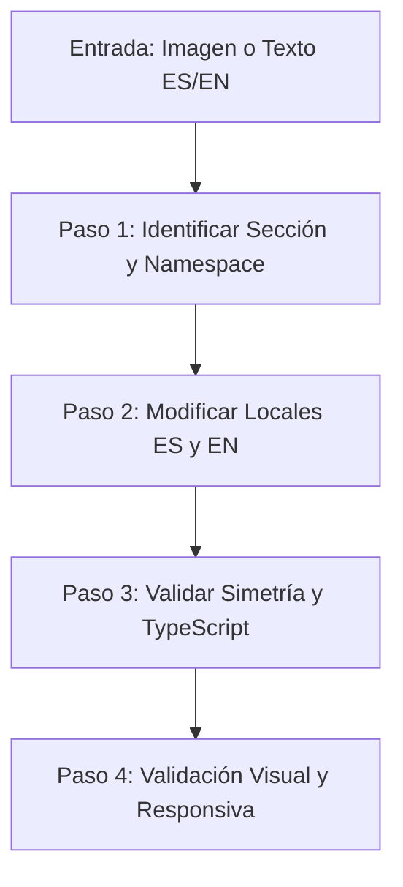

# i18n Content Updater — Andes Gaming

Esta skill guía el flujo completo para modificar o actualizar textos en cualquier sección de la web de Andes Gaming a partir de una captura de pantalla, diseño o instrucción textual, garantizando la consistencia en **Español (`es`)** e **Inglés (`en`)**, la simetría de las claves y la correcta adaptación visual responsiva.

---

## Flujo de Trabajo en 4 Pasos



---

## Paso 1: Identificación de la Sección y el Namespace

1. **Analizar la Entrada**:
   - **Si el usuario entrega una imagen**:
     - Lee el texto visible (títulos, subtítulos, badges, párrafos, botones).
     - Identifica los elementos del layout que rodean el texto (p. ej., menú superior, tarjetas de métricas, slider de marcas, grid de tarjetas, formulario).
   - **Si el usuario entrega un texto**:
     - Identifica el texto en Español (`es`) y en Inglés (`en`).
     - Si el usuario solo proveyó uno de los idiomas, traduce el faltante manteniendo el tono corporativo B2B de Andes Gaming (tecnológico, sobrio, orientado a operadores y agregación de iGaming).
2. **Localizar la Clave y el Namespace**:
   - Consulta el mapa detallado: [sections_map.md](./references/sections_map.md).
   - Usa `grep_search` con fragmentos clave del texto existente:
     ```bash
     Query: "fragmento del texto actual"
     SearchPath: "c:\APPS-REACT\andes-gaming\src\i18n\locales\es"
     ```
   - Si el texto buscado no aparece en `src/i18n/locales/`, busca en `src/pages/` o `src/components/` para verificar si estaba hardcodeado (p. ej. en componentes en desarrollo). De ser así, extráelo hacia el namespace correspondiente usando `useTranslation`.

### Tabla Rápida de Namespaces:
- **`common`**: `Header`, `Footer`, `ChatWidget`, modales de envío de formularios.
- **`home`**: Página principal (`/`) — Hero, Métricas, About ("¿Qué es Andes Gaming?"), Presencia LATAM, Juegos Propios, Infraestructura, Tarjetas de Productos, Flujo de Integración, Slider de Juegos, Contacto.
- **`aboutPage`**: Página Nosotros (`/nosotros`) — Hero, Historia/Hitos, Misión/Visión/Valores, Mapa regional, Contacto.
- **`casinoAggregation`**: Página Producto Casino Aggregation (`/productos/casino-aggregation`) — Hero, Marcas, Beneficios, Integración técnica, Proveedores, Casos de éxito.
- **`gameProvider`**: Página Game Providers (`/game-provider`) — Hero, Catálogo de proveedores, Conviértete en socio.
- **`contactPage`**: Página Contacto (`/contacto`) — Información de contacto, etiquetas y campos del formulario.
- **`blog`**: Blog (`/blog`) — Hero, Artículos destacados, Filtros de catálogo, Modal de lectura y artículos (`posts.<slug>`).

---

## Paso 2: Ejecución de la Modificación (Locales ES y EN)

Ambos archivos deben mantenerse 100% simétricos:
- Español: `src/i18n/locales/es/<namespace>.ts`
- Inglés: `src/i18n/locales/en/<namespace>.ts`

### Reglas de Edición:
1. **Simetría Estricta**: Toda clave agregada o modificada en `es` debe existir con exactamente la misma estructura de tipos en `en`.
2. **Conservación de Tokens de Interpolación**: Si el texto contiene variables (p. ej. `{{name}}` o `{{year}}`), deben mantenerse idénticas en ambos idiomas.
3. **Puntuación y Mayúsculas**: Respetar acentos, signos de apertura en español (`¿`, `¡`) cuando corresponda, y la convención de títulos del proyecto.
4. **Uso de Herramientas**: Utiliza `replace_file_content` o `multi_replace_file_content` para modificar los bloques exactos en ambos archivos.

---

## Paso 3: Validación Automatizada y Tipado

Ejecuta las dos verificaciones indispensables para asegurar que no hay discrepancias ni errores de compilación:

1. **Validación de Simetría i18n**:
   Ejecuta el script dedicado de la skill:
   ```powershell
   node --experimental-strip-types .\.agents\skills\i18n-content-updater\scripts\validate-locales.mjs
   ```
   *El script verificará recursivamente que todas las claves en ES existan en EN, que no haya cadenas vacías y que coincidan los tokens de interpolación.*

2. **Validación de TypeScript y Build**:
   ```powershell
   npm.cmd run build
   ```
   *Garantiza que TypeScript no detecte errores en los tipos `as const` o en el consumo de los componentes.*

---

## Paso 4: Validación Visual y Adaptación Responsiva

Una modificación de texto puede alterar el balance visual debido a que el español y el inglés tienen distintas longitudes de palabras y frases.

### 1. Puntos Críticos de Inspección:
- **Desbordamiento Horizontal (Overflow)**: Verificar que títulos largos o palabras extensas no fuercen scroll horizontal ni se corten en tarjetas fijas.
- **Saltos de Línea Extraños**: Evitar palabras huérfanas en titulares principales. En títulos hero, el texto se divide comúnmente en `titleFirst` y `titleSecond` para controlar el balance en dos líneas.
- **Botones y Badges**: Comprobar que los textos no empujen iconos ni rompan el padding interior.
- **Modales y Diálogos**: En el Blog y en el formulario de contacto, comprobar que el texto no tape los botones de cierre o envío.

### 2. Comprobación Multi-Dispositivo:
Verifica el comportamiento en los 3 breakpoints estándar:
- **Desktop**: 1440px / 1280px (pantalla ancha, verificar balance de columnas).
- **Tablet**: 768px (verificar cuando las columnas se apilan o reducen ancho).
- **Mobile**: 375px / 390px (pantalla pequeña, verificar que el tamaño de fuente y padding se adapten sin cortar palabras).

### 3. Comprobación del Cambio de Idioma:
- Accede a la aplicación en el navegador (`npm.cmd run dev` o servidor activo).
- Alterna el botón de idioma en el Header (ES ↔ EN).
- Valida que el texto nuevo aparezca instantáneamente en ambos idiomas sin recargar la página.

### 4. Ajustes CSS si el Texto Altera el Diseño:
Si un texto más largo en uno de los idiomas genera problemas visuales:
- Usa `text-wrap: balance;` o `text-wrap: pretty;` en el archivo `.module.css` correspondiente para equilibrar los saltos de línea.
- Revisa tamaños de fuente con `clamp(...)` si el título sobrepasa el contenedor.
- Evita alturas fijas (`height: 200px`); prefiere `min-height` o layouts flexibles con Flexbox / CSS Grid.

---

## Resumen del Checklist de Éxito

- [ ] Texto extraído / traducido con precisión para Español e Inglés.
- [ ] Sección, componente y namespace identificados correctamente.
- [ ] Archivos `src/i18n/locales/es/<ns>.ts` y `src/i18n/locales/en/<ns>.ts` editados simétricamente.
- [ ] Script `validate-locales.mjs` ejecutado con resultado exitoso (0 errores).
- [ ] Build de TypeScript (`npm.cmd run build`) completado con éxito.
- [ ] Validación visual completada en desktop, tablet y mobile comprobando que el texto se adapte sin desbordamientos.
